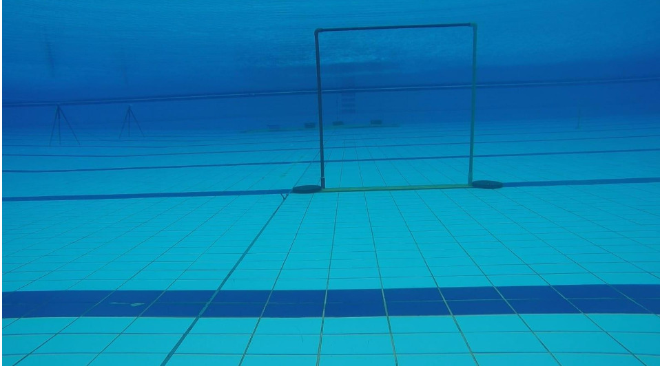
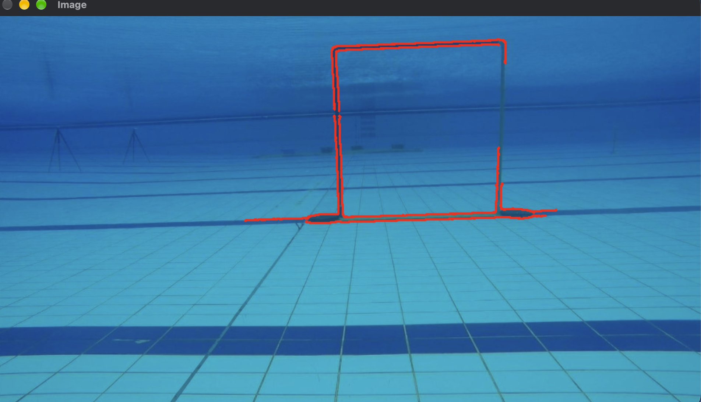

# OpenCV Underwater Contours

A beginner OpenCV experiment using image preprocessing, Canny edge detection, and contour filtering to highlight an underwater frame.

## What it does

1. Loads the sample underwater image.
2. Converts the image from BGR to HSV.
3. Applies an 11 × 11 Gaussian blur.
4. Uses Canny edge detection with thresholds of 50 and 115.
5. Finds contours and draws those with areas between 0 and 20 pixels squared in red.
6. Displays the result until a key is pressed.

## Setup and run

Use Python 3 in a local desktop environment. Run these commands from the repository root:

```bash
python3 -m venv .venv
source .venv/bin/activate
python -m pip install -r requirements.txt
python pythong/Recuitmentask.py
```

On Windows, activate the environment with `.venv\Scripts\activate`.

The script uses the relative path `pythong/task.jpg`, so run it from the repository root. Press a key while the image window is focused to close it.

## Sample input



## Sample output



## Limitations

This is a learning experiment on one sample image. The contour area limits and edge thresholds are specific to this experiment. The output may contain gaps and unwanted contours; it does not perform general underwater object recognition.

## Possible next steps

- Experiment with HSV color masking.
- Compare preprocessing and threshold settings.
- Filter contours using shape and size.
